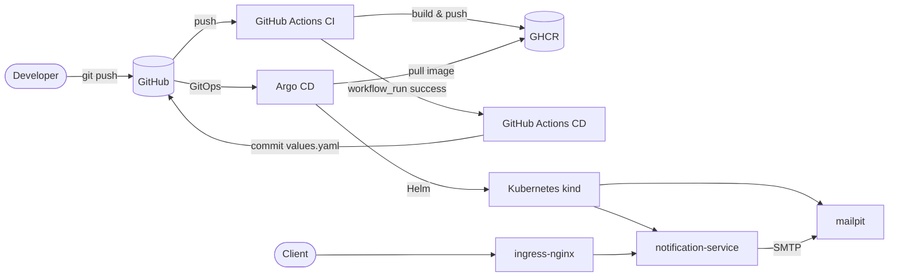

# Notification Service

Email notification microservice berbasis Express, Nodemailer, dan in-memory
queue. Repository ini  menjadi proof of concept pipeline CI/CD end-to-end:
GitHub Actions → GHCR → Argo CD → Kubernetes (kind).

## Arsitektur


## Struktur repository

```text
.github/workflows/
  ci.yaml                    # test, build, push image
  cd.yaml                    # promote image tag, commit, sync Argo CD
src/                         # aplikasi Express
helm/notification-service/   # chart deployment
argocd/application.yaml      # definisi Argo CD Application
runner-notification.yaml     # self-hosted runner (actions-runner-controller)
legacy/k8s/                  # manifest lama, tidak dipakai Argo CD
```

## Menjalankan aplikasi secara lokal

```bash
cp .env.example .env
npm ci
npm run dev
```

API:

```bash
curl -i -X POST http://localhost:3000/notifications \
  -H 'Content-Type: application/json' \
  -d '{
    "to": "test@example.com",
    "subject": "Test notification",
    "text": "Tes notif"
  }'
```

Request yang valid dibalas `202` setelah masuk queue. Queue saat ini in-memory,
jadi item yang belum terkirim hilang ketika proses berhenti.

## Testing

```bash
npm run typecheck
npm run build
npm test
```

Test integrasi SMTP hanya berjalan jika `SMTP_TEST_TO` diisi. Tanpa variabel
tersebut, test integrasi akan di-skip.

## Bootstrap Kubernetes

Prasyarat:

- Cluster kind dengan `ingress-nginx`.
- Argo CD terpasang di namespace `argocd`.
- actions-runner-controller dan GitHub token untuk runner.
- Akses ke GHCR (image saat ini public).

Apply Argo CD Application:

```bash
kubectl apply -f argocd/application.yaml
kubectl get application -n argocd notification-service
```

Apply self-hosted runner:

```bash
kubectl apply -f runner-notification.yaml
kubectl get runner -n actions-runner-system
```

Runner harus memiliki label `notification-service` karena workflow CD memakai:

```yaml
runs-on:
  - self-hosted
  - notification-service
```

## Demo end-to-end

### 1. Verifikasi image yang berjalan

```bash
kubectl get deploy -n notif notification-service \
  -o jsonpath='{.spec.template.spec.containers[0].image}{"\n"}'
```

### 2. Kirim notifikasi

```bash
kubectl port-forward -n notif service/notification-service 3000:80
```

Request endpoint

```bash
curl -i -X POST http://localhost:3000/notifications \
  -H 'Content-Type: application/json' \
  -d '{
    "to": "test@example.com",
    "subject": "Test notification",
    "text": "Tes notif"
  }'
```

### 3. Lihat email di Mailpit

Forward mailpit ui ke <http://localhost:8025>
```bash
kubectl port-forward -n notif service/mailpit 8025:8025
```


### 4. Uji melalui Ingress

```bash
kubectl port-forward -n ingress-nginx service/ingress-nginx-controller 8080:80
curl -i -X POST http://notification.test.com:8080/notifications \
  --resolve notification.test.com:8080:127.0.0.1 \
  -H 'Content-Type: application/json' \
  -d '{
    "to": "test@example.com",
    "subject": "Test via ingress",
    "text": "Tes notif via ingress"
  }'
```

## CI/CD

### CI

`.github/workflows/ci.yaml` berjalan pada push ke `master` dan pull request
yang menyentuh kode aplikasi. Tahapannya:

1. `npm ci`
2. `npm run typecheck`
3. `npm run build`
4. `npm test`
5. Build dan push image ke GHCR (hanya pada push atau manual dispatch, bukan pull request).

Image diberi tag `sha-<7 karakter commit>`, `master`, dan `latest`.

### CD

`.github/workflows/cd.yaml` berjalan setelah workflow CI sukses di `master`.
CD akan:

1. Menghitung tag `sha-<commit>`.
2. Mengubah `helm/notification-service/values.yaml`.
3. Commit dan push perubahan.
4. Login ke Argo CD.
5. Sync dan menunggu aplikasi sehat.

Argo CD kemudian menarik image baru dan menerapkan chart Helm. Tidak ada
`kubectl apply` manual di pipeline.

## Konfigurasi

Nilai utama ada di `helm/notification-service/values.yaml`.

| Variabel | Default | Keterangan |
|---|---|---|
| `NODE_ENV` | `production` | Environment aplikasi. |
| `PORT` | `3000` | Port HTTP aplikasi. |
| `SMTP_HOST` | `mailpit` | Host SMTP. |
| `SMTP_PORT` | `1025` | Port SMTP. |
| `SMTP_SECURE` | `false` | Gunakan TLS jika `true`. |
| `SMTP_USER` | kosong | User SMTP. |
| `SMTP_PASSWORD` | kosong | Password SMTP. |
| `MAIL_FROM` | `no-reply@example.com` | Alamat pengirim. |
| `LOG_LEVEL` | `info` | Level log Pino. |

Untuk produksi, isi `SMTP_USER`/`SMTP_PASSWORD` melalui secret manager, bukan
commit ke Git.

## Keterbatasan

- Queue masih in-memory; jangan menaikkan replika atau mengaktifkan HPA sebelum
  queue dipindahkan ke broker eksternal.
- Mailpit hanya untuk demo; nonaktifkan `mailpit.enabled` untuk produksi.
- Secret masih berupa nilai Helm; gunakan Sealed Secrets/External Secrets/SOPS
  untuk environment nyata.
- Self-hosted runner tidak boleh dipakai untuk workflow pull request dari fork.

## Dokumentasi tambahan

- [Legacy Kubernetes manifests](legacy/k8s/README.md)
