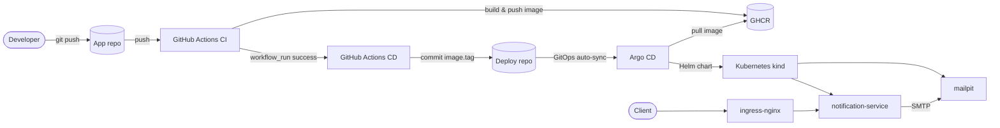

# Notification Service

Email notification microservice berbasis Express, Nodemailer, dan in-memory
queue. Repository ini berisi **kode aplikasi dan pipeline CI/CD**. Konfigurasi
deployment (Helm chart dan Argo CD Application) berada di repository terpisah:

- Aplikasi dan pipeline: `penicili/notification-service` (repo ini)
- Konfigurasi deployment: [`penicili/notification-service-deploy`](https://github.com/penicili/notification-service-deploy)

Pemisahan ini membuat kode aplikasi dan konfigurasi environment punya riwayat
commit, hak akses, dan siklus rilis yang berbeda.

## Arsitektur



Alur singkat:

1. Push ke repo ini memicu CI: typecheck, build, test, lalu push image ke GHCR
   dengan tag `sha-<commit>`.
2. Setelah CI sukses, CD menulis `image.tag` ke `values.yaml` di **deploy
   repo**, lalu commit dan push ke sana.
3. Argo CD mendeteksi perubahan di deploy repo dan menerapkan chart Helm.

## Struktur repository

```text
.github/workflows/
  ci.yaml        # test, build, push image ke GHCR
  cd.yaml        # promote image tag ke deploy repo, tunggu Argo CD
src/             # aplikasi Express
Dockerfile
package.json
```

Yang **tidak** ada di repo ini: Helm chart, manifest Kubernetes, dan Argo CD
Application. Semua ada di deploy repo.

## Menjalankan aplikasi secara lokal

```bash
cp .env.example .env
npm ci
npm run dev
```

API:

```bash
curl -i -X POST http://localhost:3000/notifications \
  -H 'Content-Type: application/json' \
  -d '{
    "to": "test@example.com",
    "subject": "Test notification",
    "text": "Tes notif"
  }'
```

Request yang valid dibalas `202` setelah masuk queue. Queue saat ini in-memory,
jadi item yang belum terkirim hilang ketika proses berhenti.

## Testing

```bash
npm run typecheck
npm run build
npm test
```

Test integrasi SMTP hanya berjalan jika `SMTP_TEST_TO` diisi. Tanpa variabel
tersebut, test integrasi akan di-skip. CI sengaja mengosongkan variabel ini
karena `ubuntu-latest` tidak memiliki SMTP server.

## CI

`.github/workflows/ci.yaml` berjalan pada push ke `master`, pull request, dan
manual dispatch, tetapi hanya jika ada perubahan pada:

- `src/**`
- `Dockerfile`
- `package.json`, `package-lock.json`, `tsconfig.json`
- `.github/workflows/ci.yaml`

Tahapannya:

1. `npm ci`
2. `npm run typecheck`
3. `npm run build`
4. `npm test`
5. Build dan push image ke GHCR (hanya push/manual dispatch, bukan pull request).

Image diberi tag `sha-<7 karakter commit>`, `master`, dan `latest`.

## CD

`.github/workflows/cd.yaml` berjalan setelah workflow CI sukses di `master`.
Job berjalan di self-hosted runner di dalam cluster karena perlu mengakses
`argocd-server.argocd`.

Langkahnya:

1. Checkout **deploy repo** menggunakan `DEPLOYMENT_REPO_TOKEN`.
2. Hitung tag `sha-<commit>` dari commit yang diuji CI.
3. Ubah `image.tag` di `helm/notification-service/values.yaml` memakai `yq`.
4. Commit dan push ke deploy repo.
5. Refresh Argo CD dan tunggu sampai aplikasi `Synced` dan `Healthy`.
6. Verifikasi image tag benar-benar muncul di Argo CD.

CD tidak melakukan sync manual karena Argo CD sudah memakai `automated` sync.
Sync manual bisa bentrok dengan sync otomatis yang sedang berjalan.

### Secret yang dibutuhkan

| Secret | Fungsi |
|---|---|
| `DEPLOYMENT_REPO_TOKEN` | Token dengan akses `contents: write` ke deploy repo, untuk checkout dan push. |
| `ARGOCD_CLI_PASSWORD` | Password user `admin` Argo CD untuk login CLI. |

`GITHUB_TOKEN` hanya dipakai untuk push image ke GHCR.

## Menjalankan deployment

Bootstrap Argo CD Application dan self-hosted runner dilakukan dari deploy
repo:

```bash
git clone git@github.com:penicili/notification-service-deploy.git
cd notification-service-deploy

kubectl apply -f argocd/application.yaml
kubectl apply -f runner-notification.yaml
```

Prasyarat: cluster kind dengan `ingress-nginx`, Argo CD di namespace `argocd`,
dan actions-runner-controller untuk runner.

## Demo end-to-end

### 1. Verifikasi image yang berjalan

```bash
kubectl get deploy -n notif notification-service \
  -o jsonpath='{.spec.template.spec.containers[0].image}{"\n"}'
```

### 2. Kirim notifikasi

```bash
kubectl port-forward -n notif service/notification-service 3000:80
```

Request endpoint:

```bash
curl -i -X POST http://localhost:3000/notifications \
  -H 'Content-Type: application/json' \
  -d '{
    "to": "test@example.com",
    "subject": "Test notification",
    "text": "Tes notif"
  }'
```

### 3. Lihat email di Mailpit

```bash
kubectl port-forward -n notif service/mailpit 8025:8025
```

Buka <http://localhost:8025>.

### 4. Uji melalui Ingress

```bash
kubectl port-forward -n ingress-nginx service/ingress-nginx-controller 8080:80
curl -i -X POST http://notification.test.com:8080/notifications \
  --resolve notification.test.com:8080:127.0.0.1 \
  -H 'Content-Type: application/json' \
  -d '{
    "to": "test@example.com",
    "subject": "Test via ingress",
    "text": "Tes notif via ingress"
  }'
```

## Konfigurasi

Semua nilai environment (`SMTP_HOST`, `SMTP_PORT`, `SMTP_USER`, `MAIL_FROM`,
resource, ingress, Mailpit, dan HPA) ada di
`helm/notification-service/values.yaml` pada **deploy repo**, bukan di repo ini.

| Variabel | Default | Keterangan |
|---|---|---|
| `NODE_ENV` | `production` | Environment aplikasi. |
| `PORT` | `3000` | Port HTTP aplikasi. |
| `SMTP_HOST` | `mailpit` | Host SMTP. |
| `SMTP_PORT` | `1025` | Port SMTP. |
| `SMTP_SECURE` | `false` | Gunakan TLS jika `true`. |
| `SMTP_USER` | kosong | User SMTP. |
| `SMTP_PASSWORD` | kosong | Password SMTP. |
| `MAIL_FROM` | `no-reply@example.com` | Alamat pengirim. |
| `LOG_LEVEL` | `info` | Level log Pino. |

Untuk produksi, isi `SMTP_USER`/`SMTP_PASSWORD` melalui secret manager, bukan
commit ke Git.

## Keterbatasan

- Queue masih in-memory; jangan menaikkan replika atau mengaktifkan HPA sebelum
  queue dipindahkan ke broker eksternal.
- Mailpit hanya untuk demo; nonaktifkan `mailpit.enabled` untuk produksi.
- Secret masih berupa nilai Helm; gunakan Sealed Secrets/External Secrets/SOPS
  untuk environment nyata.
- Self-hosted runner tidak boleh dipakai untuk workflow pull request dari fork.
- Image memakai tag, bukan digest; pin ke digest dan image signing belum
  diterapkan.

## Dokumentasi tambahan

- [Deploy repo](https://github.com/penicili/notification-service-deploy) —
  Helm chart, Argo CD Application, dan runner manifest.
- [Legacy Kubernetes manifests](https://github.com/penicili/notification-service-deploy/tree/master/legacy/k8s)
  — manifest lama, tidak dipakai Argo CD.
